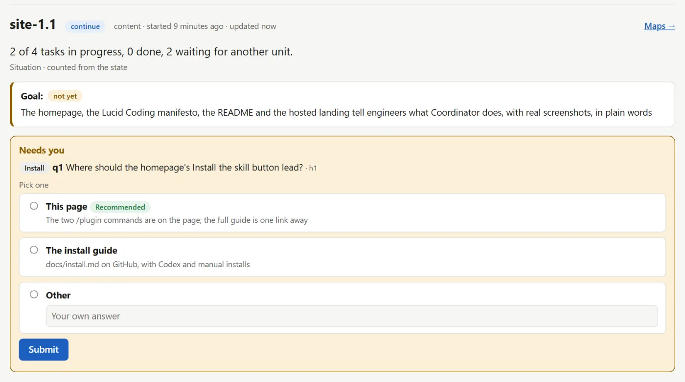
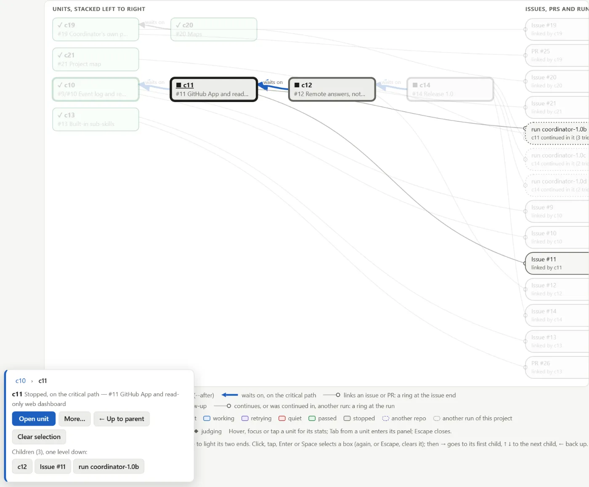

# Coordinator

**Lucid Coding for your agents.** Coordinator is an open-source agent skill for Claude Code and OpenAI Codex CLI. It runs your coding agents as a team and keeps a record you can open in a browser: how each agent read the problem, what it built, how a blind critic judged it and why, and what is running now.

Author: Asif Raja, by [Mindmakr](https://github.com/mindmakr) · Homepage: [mindmakr.github.io/coordinator](https://mindmakr.github.io/coordinator/) · [The Lucid Coding manifesto](https://mindmakr.github.io/coordinator/lucid-coding.html)

[](LICENSE)


<picture>
  <source srcset="docs/img/needs-dark.webp" media="(prefers-color-scheme: dark)">
  
</picture>

## New here? Let your agent set it up

You don't need to read the rest of this page first. Paste this into your coding agent (Claude Code, Codex, Antigravity, Cursor, Gemini CLI):

```text
Install the Coordinator skill from https://github.com/mindmakr/coordinator
(in Claude Code: /plugin marketplace add mindmakr/coordinator, then /plugin install coordinator@coordinator).
Then run its init command on this project, ask me only what you cannot work out,
and run the doctor. If this is a web or Expo app, also install reins from
https://github.com/mindmakr/reins and run its setup, so you can drive and measure the app.
```

Then ask for what you want, in your own words:

```text
/coordinator:run Build a booking page where customers pick a time and pay. Merge into dev when the review says ready.
```

The agent asks its questions once, up front, then works without you. You get a dashboard that shows what it built, how a separate critic checked it, and why it passed.

### Why bother, if my agent already writes working code?

Agents are very good at code that **looks right and works in the demo**. What they miss, when nobody checks, is what you can't see on screen:

- **Performance:** a page that loads in 4 seconds, a list that re-renders 40 times, an API call made in a loop.
- **Security:** a key in the frontend, an endpoint anyone can call, missing permission checks.
- **Scale:** a query that is fine with 10 rows and dies at 10,000; no limits, no pagination.
- **Drift:** each new feature quietly breaks an older one, and nobody notices until a customer does.

Coordinator puts a second agent on every change whose only job is to check it against a bar you agreed up front, with evidence. That matters most **after** the first version: when you refactor, fix bugs, or hand the app to someone else, the record of what was built, why, and how it was proven is what lets the next agent (or person) change it safely.

Vibe code the first version if you like. Use Coordinator when it has to keep working.

## Lucid Coding

Vibe coding is a feeling. Lucid Coding is knowing. Agentic engineering is how a lot of software is built now; Lucid Coding is the practice of doing it with your eyes open: you know your system, your agents' thinking, and how each piece was built and judged.

Coordinator brings the process, not opinions about your stack:

- **Questions first.** Every open question is asked once, before the work starts, with a recommendation. Then the run goes on without you.
- **A bar before the build.** Each unit of work gets behaviours a critic can check (`Given … when … then …`), a failing test, or a reference to match.
- **A blind critic.** Builders build. A separate critic, who never sees the builder's reasoning, checks the real result and marks each behaviour with evidence. A pass needs evidence for all of them.
- **Stops in code.** Round and time budgets, no-progress and same-cause detection, and a cap on scope added mid-run are enforced by a script.
- **Everything on the record.** Every step is an append-only event log. The dashboard, the maps and the text view are drawn from it, and a crash resumes from it.
- **It learns.** Each run ends with a retro that carries lessons and tuned budgets into the next one.

Get the work done first. Speed and cost improve with time and experience, and each run's record is where that experience comes from.

## How a run works

```
 intake ─────► bar ─────► build ─────► judge ─────► next
 ask once,     behaviours   one fresh    one blind     ├─ build again: fix the biggest gap
 research,     a critic     builder      critic        ├─ change strategy: the same gap came back
 staff team    can check    per unit     per round     ├─ stop: budget spent, no progress, stuck
                                                        └─ integrate ─► report ─► retro (learn)
```

1. **Intake.** The lead reads the project and the task, researches references, picks agents for each role from the ones your harness already has, and asks every open question in one batch, recommendation first. Your answers, including standing permissions such as "merge when the review says ready", go on the record.
2. **Loop.** Builders work in parallel where units are independent, each in its own git worktree. Critics judge the real artifact. `run.mjs next` decides what happens to each unit and refuses any step taken out of order.
3. **Finish.** An integrator checks that the parts fit. You get a short report: the outcome, the evidence, what stopped and why, and the decisions made for you.
4. **Retro.** Repeated gaps become lessons, past runs tune the budgets, and gaps in the skill itself become proposals here, with your approval.

## Install

**Claude Code plugin**

```
/plugin marketplace add mindmakr/coordinator
/plugin install coordinator@coordinator
```

Then, in a project:

```
/coordinator:init
/coordinator:run Fix issue #142 (wrong totals on the dashboard). Merge into dev when the review says ready.
```

**Google Antigravity and Gemini CLI:** copy the same folders where that tool reads skills and add its rule; runs go only through `run.mjs` ([harnesses.md](skills/coordinator/references/harnesses.md)). Several tools can run leads on one project at once; each run records which tool and skill version wrote it.

**OpenAI Codex CLI:** copy every folder under `skills/` into the project's `.agents/skills/`, add the [AGENTS.md block](skills/coordinator/references/codex.md#agentsmd-block), and ask for the coordinator skill by name. Codex has no question tool, so questions go to the dashboard ([what differs](skills/coordinator/references/codex.md)).

**Any skills-capable harness:** copy every folder under `skills/` into your skills folder. Installed this way, the commands are `/coordinator init`, `/coordinator run <task>` and so on.

**Needs:** Node 18+ and git. No other dependencies. Add `.coordinator/` to your project's `.gitignore`. The full guide is [docs/install.md](docs/install.md).

## Commands

| Command | What it does |
|---|---|
| `/coordinator:init` | Learns the project once: checks, protected branches, risk areas, standing rules. Asks where run state goes, the theme, budgets, the merge rule and the hosted app. Writes `COORDINATOR.md` and `.coordinator/coordinator.json`, then runs doctor |
| `/coordinator:dashboard` | Every run on this PC, live: across projects and tools (Claude Code, Codex, Antigravity, Gemini CLI), grouped by project, each linked. One per machine on port 7480; run it again and it prints the link. `stop` stops it |
| `/coordinator:doctor` | Checks the setup, one line per item with a fix: Node, plugin version, `gh` login and scopes, git remote, `COORDINATOR.md`, settings, stale locks and dashboards, stored evidence, worktree links, lessons, Codex. `--json`, `--offline` |
| `/coordinator:run <task>` | Intake, then the loop until the bar is met. Takes an issue, a PR, or a plain description |
| `/coordinator:status [run]` | Where a run stands, in a compact text view, or picks it up after a break or a crash |
| `/coordinator:retro <run>` | Lessons, budgets and proposals from a finished run |

Each step also has its own playbook you can run alone: `/coordinator:investigate`, `plan`, `fix`, `review` (with a security pass and a project-rule pass every round), `verify`, `visual`, `translations`, `release-notes` (for testers, operators and users) and `board`. If your project has its own skill for a step, that one is used instead.

## Picking up a run

A run survives a crash, a closed session or days away. Everything is in `.coordinator/runs/<run>/`: the event log (`events.jsonl`), a snapshot derived from it (`state.json`), a readable `workbench.md`, and the evidence the run adopted.

1. **Check the setup first:** `/coordinator:doctor`. It finds stale locks, dashboards that are no longer running, and stored evidence that went missing.
2. **See where things stand:** `/coordinator:status`. With no run named, it takes the most recent open one and prints what is done, what is running, what stopped and why, and whether anything needs you.
3. **Carry on.** The lead checks each unit that was building against its branch, worktree or output, sends a unit with nothing to show back to build (`run.mjs reset`), and continues with `run.mjs next`. Your answers from intake are in the run's notes, so it does not ask them again.

**What survives:** your answers and notes, the goal, bar and fence, every round with the builder's report and the critic's verdict, decisions, follow-ups and evidence files. Before a worktree is removed, `run.mjs adopt <run>` copies the screenshots and reports the run mentions into the run folder, so deleting the worktree loses nothing.

**A new run or `--continues`?** Start a new run for new work. When a new run finishes a unit an earlier run left open, link it: `run.mjs init <new-run> … --continues <run>:<unit>`. Both runs record the link, the dashboard and maps show the chain, and the stats count it as one unit.

**On another machine:** the lead pushes the run to the repo's `coordinator-state` branch at pit stops (a unit merged, a decision, the run closed), and `run.mjs pull <run>` restores it elsewhere. A public repo never holds run state: set `stateRepo` in `.coordinator/coordinator.json` to a private companion repo ([durability](skills/coordinator/references/durability.md), [connect](docs/connect.md)). Evidence files stay on the machine that made them.

## See it

<picture>
  <source srcset="docs/img/walk-dark.webp" media="(prefers-color-scheme: dark)">
  
</picture>

**Local or hosted?** `/coordinator:dashboard` is for one developer: every run on this PC, served from your machine. The hosted app (below) is for a team or the cloud: runs pushed to GitHub, readable by whoever can read the repo.

`run.mjs serve <run>` serves a live dashboard on 127.0.0.1, behind a token made at each start. It updates in place over Server-Sent Events.

- **Is it finished, and how near?** One status word (Running, Waiting on you, Finishing, or Concluded: done, partial or stopped, with its reason), units done with a percentage and a progress bar, the round in progress, and the time left with the clock time it should be ready. A concluded run says "This run is finished" and what it delivered. `run.mjs status-line <run>` prints the same as one line, which the lead posts in the chat at each milestone and at least every 30–45 minutes; `/coordinator:status` starts with one line per run.
- **Situation, goal, Needs you.** One plain line on where the run stands, the goal with its behaviours and evidence, and the questions waiting for you with answer forms, recommended option first.
- **Who waits on whom.** A unit waiting for another says **Waiting for A** and links to it; the waited-on unit says **Blocks: D**. Only a unit with an open question for you is amber and says **Needs you**.
- **A page per unit.** Behaviours, evidence, every round (builder's report, critic's verdict, score, root cause), which model built and judged it, notes, issue and PR links, and its own timeline.
- **Maps.** Flow (what waits on what, the critical path, linked issues, PRs and follow-on runs), goal relevance (work off the goal stands out), mind and heat (effort and churn per hour). Select a box, then walk the map with the arrow keys.
- **A report per run** (`/report`, `report.html`): release notes for devops and testers that the lead stores with `run.mjs report <run> --file`, started from a draft read from the run and git (`--draft`: PRs, merges, migrations, env vars, scripts, jobs), and code quality and compliance signals from `run.mjs quality <run|--project>`: duplication, function length, nesting, naming, unused files, security (secrets, eval, SQL by concatenation, TLS off, open CORS, unguarded routes) and privacy for PDPL and GDPR. Each signal carries file:line evidence for a person to review; it is not a compliance certification ([quality.md](skills/coordinator/references/quality.md)).
- **A retro page** (`/retro`, `retro.html`): retro notes, lessons added, budgets, upstream proposals and escapes. Once every unit is decided the dashboard shows **Retro pending** with `/coordinator:retro <run>`.
- **The coordinator's own page.** **Active runs** at the top (each one's status, progress and ETA, and when the machine frees up), then across every run in the project: pass rate, rounds to pass and time per unit with the trend, work carried across runs, lessons with their sources, and proposals.
- **Project map.** `run.mjs map <run>` maps modules and imports, shared helpers, settings keys, routes and screens, and functions with the same shape, with Node built-ins only. `run.mjs calls <run> <unit>` lists the JS/TS functions a unit's diff touched, what they call and what calls them, on the unit page and in the maps page's Calls view ([map.md](skills/coordinator/references/map.md)).
- **Export PDF** on every page, and a script-free `hud.html` snapshot beside the state. `run.mjs show <run>` prints the same view as text.
- **Looks like your project.** `init --theme app/globals.css` maps your design system's colours, fonts and radius onto it.

## Follow runs from anywhere

The service in [`service/`](service/README.md) is a GitHub App and a web dashboard. It reads the `coordinator-state` branch and shows each run, drawn by the same renderers, to the people who can read that repo on GitHub. Answer the lead and add notes there or in an issue comment (`/coordinator answer q3 b`), and get web push, email or GitHub alerts when a run needs you. Builders and critics still run on your machine.

- **Self-host today:** one container and Postgres, with your own GitHub App ([self-host](docs/self-host.md)).
- **Hosted:** app.coordinator.mindmakr.com is opening soon, free during the beta ([#42](https://github.com/mindmakr/coordinator/issues/42)).

| Doc | What |
|---|---|
| [Install](docs/install.md) | Claude Code and Codex CLI |
| [Connect](docs/connect.md) | The App, the state branch, `coordinator.json` |
| [Self-host](docs/self-host.md) | One container and your own GitHub App (Docker, Dokploy) |
| [Permissions](docs/permissions.md) | Each App permission and why |
| [Privacy](docs/privacy.md) | What the hosted service keeps, for how long, and what never leaves your machine |

## Model routing

Mechanical builder work (docs, copy, translations, renames, fixtures) can go to a cheaper model. Critics, the integrator, and builders on security, money, migrations or auth never go below the strong model. Each round records which model built it and which judged it, and `stats` gives a pass rate per builder model. On by default; off or a custom table in `.coordinator/coordinator.json` ([routing.md](skills/coordinator/references/routing.md)).

## Helper models: small jobs off the expensive model

Summaries of what an agent did, picks from a fixed list, and a first look at screenshots can go to a small model on your own machine (Ollama, LM Studio, another PC on your network) or through a router (OpenRouter, OpenAI, any OpenAI-compatible gateway). One command sets it up: `node <skill-dir>/scripts/helper.mjs setup ollama`. Answers are typed; anything unsure is handed back to the strong model, and a helper never judges. Off by default, and nothing depends on it ([helpers.md](skills/coordinator/references/helpers.md)).

## Companion: reins

[**reins**](https://github.com/mindmakr/reins) ([site](https://mindmakr.github.io/reins/) · [examples](https://github.com/mindmakr/reins-examples)) is the companion tool for web (Vite, Next.js, React) and Expo apps. While Coordinator runs the builder and blind-critic loop, **reins** sits inside your app during development (< 5 KB core, stripped from production builds and checked by `reins-verify-bundle`) and gives builders and visual critics 9 MCP tools (plus WebMCP) to trigger typed actions (`login-as-tester`, `set-locale`), read store snapshots, inspect network calls and console errors, measure page lifecycle, component mount/render and API latency (`reins_perf`), inspect DOM subtrees with computed CSS and overflow/clipping flags (`reins_dom`), and snap exact panel screenshots by id (`reins_snap`) instead of clicking by pixels. With `reins/node` on the backend, one timeline runs from the click through the fetch, the server route and its database spans, back to the panel's re-render (`reins_server`). `reins_report` turns a session into a Markdown report that a Coordinator critic attaches as evidence, `npx reins report --compare` shows what a change made faster or slower, and testers can record a session on a staging build and export it for an agent to analyse. Its own agent skill (`/reins:setup`) wires an existing or new app automatically.

## Safe by default

- Network calls only where you ask for them: `run.mjs push` and `pull` run git against your own remotes at pit stops; `run.mjs watch --remote` pulls the state branch on a timer and can hold one connection to a coordinator service you name; doctor asks `gh` and checks the latest release tag unless `--offline`; `helper.mjs` calls the helper-model server you set up (on your machine, your network, or the router you chose), with the key read from an environment variable. Nothing else connects anywhere.
- No shell strings; ids are checked against path traversal.
- Secrets are refused in lessons and masked in run state.
- Merging, deploying, deleting, spending or posting needs your approval, given up front.
- A detector reads each diff for the usual ways to fake a green run: focused, skipped or deleted tests, removed assertions, rewritten snapshots and suppressed checks.

## 1.1: shipped so far, and coming

| Add-on | Status |
|---|---|
| Model routing with a record of which model did what | Shipped |
| `/coordinator:doctor` and setup questions in init | Shipped |
| Follow-on runs and chains (`--continues`) | Shipped |
| Waiting for A, Up next and Needs you in words and links | Shipped |
| Run report (release notes for devops and testers) and retro pages | Shipped |
| Code-quality and compliance signals (`run.mjs quality`) | Shipped |
| Function calls per unit (`run.mjs calls`, the Calls view) | Shipped |
| Evidence viewer (screenshots in a scrollable popup) | Shipped |
| Gaps view with search on the coordinator page | Shipped |
| Runs that end eagerly: severity gates, fold-in checks, finish line, cost record | Shipped |
| Local demo of the hosted app (`npm run demo`) | Shipped |

## What's inside

```
skills/<sub-skill>/SKILL.md      thin plugin entries for the sub-skills, pointing at the playbooks
skills/doctor/                   /coordinator:doctor (runs scripts/doctor.mjs)
skills/coordinator/
├── SKILL.md                    the router and the rules every command shares (<500 words)
├── references/                 one playbook per command, the bar, briefs, craft, team, routing,
│                               guardrails, durability, hud, map, quality, learning, codex, sub-skills, domains
└── scripts/                    Node 18+, zero dependencies
    ├── run.mjs                 run state and the loop's decisions
    ├── doctor.mjs              the setup check
    ├── lessons.mjs             the lesson store
    ├── detect.mjs              the bar-gaming detector
    ├── lib/                    pure modules with tests in test/
    └── test/                   node:test suites, and run folders from 0.1 to 0.5 for the migration test
docs/                           the homepage, the manifesto, and install · connect · self-host · permissions · privacy
tools/                          codex-e2e.mjs and make-old-runs.mjs
service/                        the GitHub App and web dashboard (AGPL-3.0, its own dependencies; imports scripts/lib)
```

## Contributing

Every run is a test of this skill. If a run went wrong, a rule was unclear or a guard didn't fire, open an issue. A fix is welcome as a PR. See [CONTRIBUTING.md](CONTRIBUTING.md).

```
npm test
claude plugin validate .
```

## Inspired by

- **The Gauntlet Loop** by Matt Shumer ([write-up](https://somethingbig.ai/gauntlet-loop), [example repository](https://github.com/mshumer/Claude-of-Duty)): the build, blind-critic and repeat loop.
- **[Impeccable](https://github.com/pbakaus/impeccable)** by Paul Bakaus: the command structure, the context file and the deterministic detector.

Details are in [CREDITS.md](CREDITS.md).

## Support the project

Coordinator is maintained by one author. It needs contributors, people who write up their runs, sponsors and partners, especially people who build models, coding tools and open-source agents.

- **Contribute:** report runs that went wrong, send fixes, or build an adapter for your harness ([CONTRIBUTING.md](CONTRIBUTING.md)).
- **Sponsor or partner:** credits for test runs, an adapter built together, or sponsorship, through the [sponsor or partner form](https://github.com/mindmakr/coordinator/issues/new?template=sponsor-or-partner.yml). It is a public issue, so leave out private contact and payment details.

## License

The skill, its scripts and the shared code are [MIT](LICENSE). The hosted service in `service/` is [AGPL-3.0](service/LICENSE): you may run and change it, and if you offer a changed version to others over a network, you share your changes.
